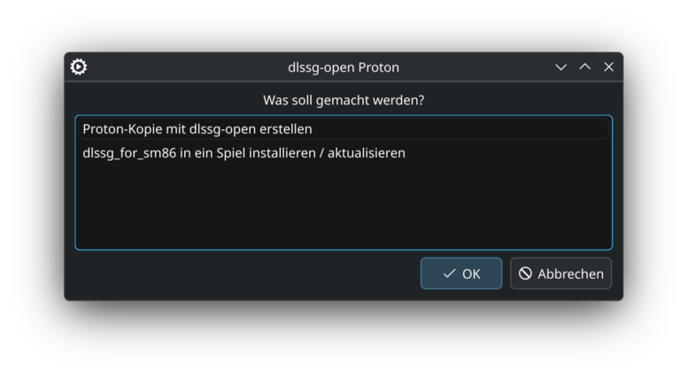
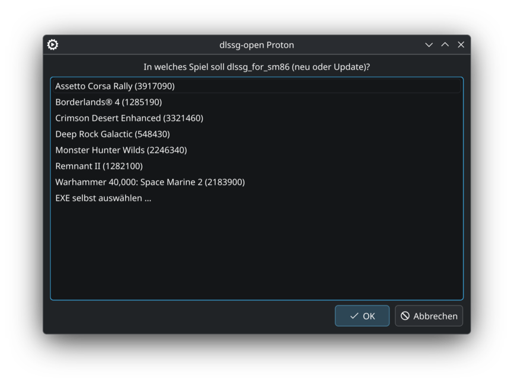
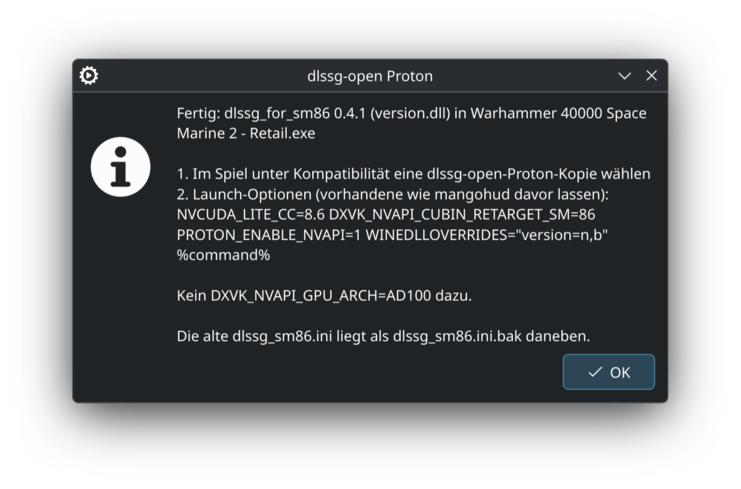

# dlssg-open Proton

[English](README.md) · **Deutsch**

**Kleines KDE-Tool, das eine installierte Proton-Version kopiert und in die Kopie
[dlssg-open](https://github.com/dniminenn/dlssg-open) einbaut.** Damit läuft DLSS Frame Generation
auf RTX-30-Karten (Ampere) unter Linux. Die Original-Proton-Version bleibt unverändert, Steam zeigt die
Kopie als eigenes Kompatibilitätstool an, z. B. „GE-Proton11-11 (dlssg-open v0.1.1)“. So bekommen nur
die Spiele den Mod, bei denen du die Kopie auswählst.

> **Nutzt derzeit den Fork [ProfessorTee/dlssg-open](https://github.com/ProfessorTee/dlssg-open)**, Release
> 0.1.1: upstream-dlssg-open 0.1.0 plus die CUDA-Module-API (`CreateCuModule` / `CreateCuFunction` / `LaunchCuKernelChain`), die
> [dlssg_for_sm86](https://github.com/sdli1995/dlssg_for_sm86) 0.4.x braucht. Upstream-PR:
> [dniminenn/dlssg-open#1](https://github.com/dniminenn/dlssg-open/pull/1). Sobald der veröffentlicht ist,
> wechselt das Tool zurück auf upstream.

<p align="center">
  
  
  
</p>

## Bedienung

1. Im Startmenü **dlssg-open Proton erstellen** öffnen (oder `dlssg-open-proton` im Terminal) und
   *Proton-Kopie mit dlssg-open erstellen* wählen.
2. Die Proton-Version auswählen, die den Mod bekommen soll.
3. Steam neu starten, im Spiel unter *Eigenschaften → Kompatibilität* die neue Version wählen.
4. In die Startoptionen des Spiels:

   ```
   DXVK_NVAPI_GPU_ARCH=AD100 NVCUDA_LITE_CC=8.9 DXVK_NVAPI_CUBIN_RETARGET_SM=86 %command%
   ```

   Mit **dlssg_for_sm86** (der Mod von sdli1995: `version.dll`, `dlssg_sm86.ini` und `dlssg_sm86\` im
   Spielordner) stattdessen das hier, ohne Architektur-Spoof (das macht der Mod, und nur so gibt es 3X / 4X):

   ```
   NVCUDA_LITE_CC=8.6 DXVK_NVAPI_CUBIN_RETARGET_SM=86 PROTON_ENABLE_NVAPI=1 %command%
   ```

   Hat das Spiel schon eine eigene `version.dll`, zusätzlich `WINEDLLOVERRIDES="version=n,b"` setzen oder
   einen der Proxys aus `alternatives\` des Mods nehmen.

   `PROTON_NVIDIA_LIBS` und `PROTON_NVIDIA_NVCUDA` **nicht** setzen, sonst wird das echte nvcuda
   statt nvcuda-lite geladen.

Rechtsklick auf den Startmenü-Eintrag → *Proton-Ordner öffnen* zeigt `compatibilitytools.d`, um alte
Kopien zu löschen. Die Oberfläche folgt der Systemsprache: Deutsch auf deutschen Systemen, sonst Englisch.

## dlssg_for_sm86 in ein Spiel

Der zweite Menüpunkt (auch *Rechtsklick auf den Startmenü-Eintrag → dlssg_for_sm86 in ein Spiel installieren /
aktualisieren* oder `dlssg-open-proton --game`) legt das neueste
[dlssg_for_sm86](https://github.com/sdli1995/dlssg_for_sm86)-Release neben die EXE eines Spiels oder
aktualisiert es dort:

- Listet die installierten Steam-Spiele mit DLSS Frame Generation und findet ihre Haupt-EXE; *Andere EXE …*
  oder *EXE selbst auswählen …* öffnet eine Dateiauswahl, damit gehen auch Spiele außerhalb von Steam.
- Lädt das Release einmal (geprüft gegen GitHubs SHA-256) und speichert es in `~/.cache/dlssg-open/`.
- Kopiert Proxy, `dlssg_sm86.ini` und `dlssg_sm86\` neben die EXE. Der Proxy ist `version.dll`; belegt ein
  anderer Mod den Namen schon, der nächste freie aus `winmm.dll`, `dbghelp.dll`, `dinput8.dll` (Reihenfolge laut
  `alternatives\README.md` des Mods). Es bleibt immer nur ein Proxy des Mods im Ordner.
- Update: alte Proxys des Mods werden entfernt, die alte INI bleibt als `dlssg_sm86.ini.bak` (eigene Änderungen
  in der neuen nachtragen). Wird der Mod als ASI-Plugin geladen (z. B. `00_dlssg_sm86.asi` neben einem
  ASI-Loader), wird diese Datei direkt aktualisiert.
- Zeigt die passenden Startoptionen an, inklusive `WINEDLLOVERRIDES` für den gewählten Proxy.

## Was das Tool macht

- Listet alle installierten Proton-Builds mit dxvk-nvapi (Steam-Proton, systemweite und eigene in
  `compatibilitytools.d`), eigene dlssg-open-Kopien ausgenommen.
- Lädt das **neueste Release** von dlssg-open über die GitHub-API, prüft die `SHA256SUMS` und
  speichert es in `~/.cache/dlssg-open/<tag>`.
- Kopiert die gewählte Proton-Version nach `compatibilitytools.d/<name>-dlssg-open-<tag>`
  (mit `--reflink`, auf btrfs also fast ohne Platz), legt eine eigene `compatibilitytool.vdf` an und
  legt `nvapi64.dll` und `nvcuda.dll` von dlssg-open in die Kopie (Protons Originale bleiben daneben als
  `.proton-orig` / `.proton-stub`, wie bei `install.py --proton` von dlssg-open). Schlägt das fehl, wird die
  Kopie wieder gelöscht.

Kommt ein neues dlssg-open- oder Proton-Release, das Tool einfach nochmal ausführen.

## Voraussetzungen

- Steam (nativ, `~/.local/share/Steam`), KDE (`kdialog`), `curl`, `tar`, `sha256sum`; kein Python (seit 2.0
  ist das Tool ein einzelnes Rust-Binary)
- RTX 30 und ein Spiel mit DLSS-G-Runtime 310.x – Details und Grenzen im
  [dlssg-open-README](https://github.com/ProfessorTee/dlssg-open/tree/cu-module-api#readme)
- dlssg_for_sm86 0.4.x braucht dlssg-open 0.1.1 (den Fork oben); mit 0.1.0 scheitert Frame Generation
  oder läuft auf NVIDIAs Original-Kernels statt denen des Mods. Getestet: 0.4.1 in Monster Hunter Wilds
  und Crimson Desert, RTX 3090, 4X.

## Installation

```
git clone https://github.com/ProfessorTee/dlssg-open-proton.git
cd dlssg-open-proton
./install.sh
```

`install.sh` baut das Tool, wenn Rust (`cargo`) installiert ist, sonst lädt es das fertige Binary aus dem
neuesten Release (x86_64, glibc ≥ 2.35).

Deinstallieren: `~/.local/bin/dlssg-open-proton` und
`~/.local/share/applications/dlssg-open-proton.desktop` löschen.

## Lizenz

MIT. dlssg-open selbst ist ein eigenes Projekt von dniminenn (ebenfalls MIT); das Tool lädt es zur Laufzeit
von den GitHub-Releases des Forks, es wird nicht mit diesem Repo verteilt.
